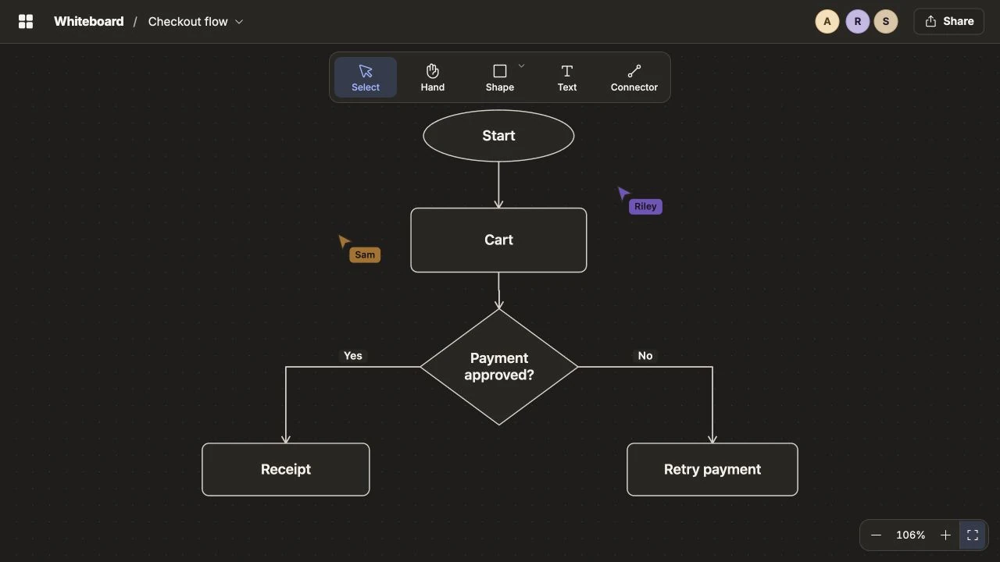
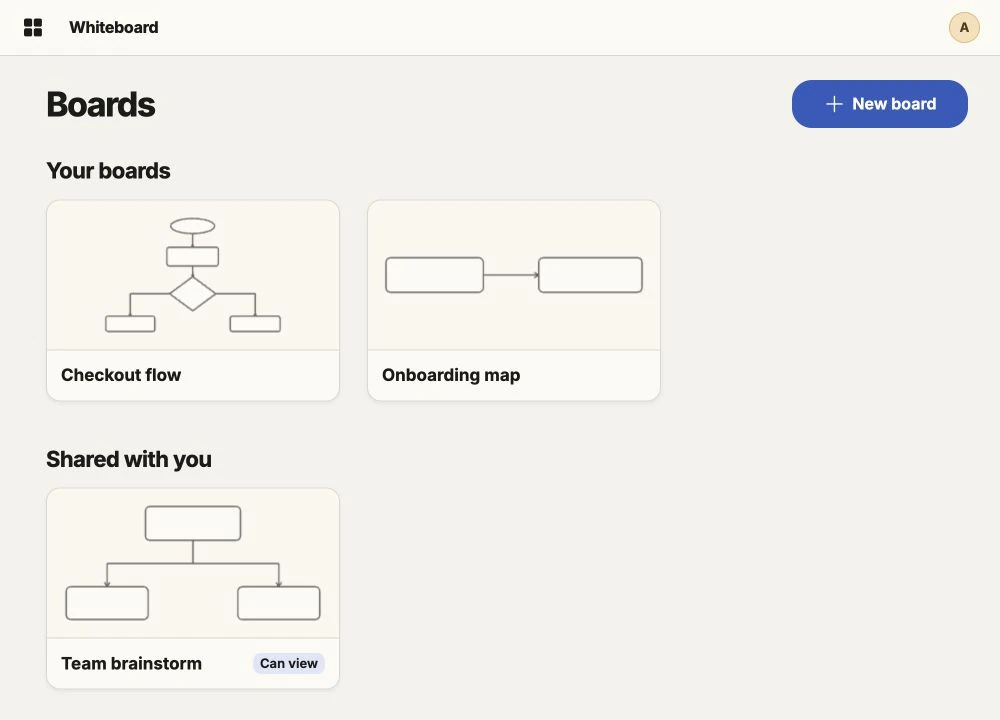

<p align="center">
  
</p>

<h1 align="center">Whiteboard</h1>

<p align="center"><strong>Draw together. Host it yourself.</strong></p>

<p align="center">
  A private whiteboard you can run yourself.<br>
  Draw a flowchart, invite a teammate, and see their cursor as they work.
</p>

<p align="center">
  <a href="https://deploy.workers.cloudflare.com/?url=https://github.com/SkyIsTheLimit/whiteboard"></a>
</p>

<p align="center">
  <a href="#quick-start">Quick start</a> · <a href="#how-to-use">How to use</a> · <a href="#deploy-to-cloudflare">Deploy to Cloudflare</a> · <a href="#how-it-works">How it works</a>
</p>





## Quick start

Use npm with Node.js 22.13+ on the 22.x line or Node.js 24 or newer. Wrangler runs D1 and Durable Objects locally.

```sh
npm ci
cp .dev.vars.example .dev.vars
```

Replace the example `BETTER_AUTH_SECRET` in `.dev.vars` with the output of `openssl rand -hex 32`. Then start the app.

```sh
npm run db:migrate
npm run dev -- --host 127.0.0.1 --port 4173 --strictPort
```

Open <http://127.0.0.1:4173> and create an account. Try two accounts in separate browser profiles to see live edits. Keep `.wrangler/state` to retain your local boards.

## How to use

- Move or resize items with **Select**. Shift-click to add items to the selection.
- Add shapes and text, then link them with **Connector**. Double-click an item to edit its label.
- Pan with **Hand**. Zoom or fit the board from the bottom-right controls.
- If you own the board, use **Share** to invite a viewer or editor. Invitees sign in to join, and the board URL stays members-only. Revoke a link to stop new joins or remove a member to end their access.

## Deploy to Cloudflare

The badge opens Cloudflare’s deployment setup. Check the bindings, configure auth, and apply the D1 migrations before opening the app. [Cloudflare deploy button guide](https://developers.cloudflare.com/workers/platform/deploy-buttons/)

For a manual deploy, create a database with `npx wrangler d1 create whiteboard`. Set its ID on the `DB` binding in `wrangler.jsonc`. Keep the `BOARD_ROOMS` binding and the SQLite class migration.

```sh
npx wrangler d1 migrations apply DB --remote
npm run deploy
```

In the Cloudflare dashboard, set `BETTER_AUTH_SECRET` to a fresh random secret and `BETTER_AUTH_URL` to the public HTTPS origin. For optional Google sign-in, set `GOOGLE_CLIENT_ID` and `GOOGLE_CLIENT_SECRET` and register `<your origin>/api/auth/callback/google` as the redirect URI.

## How it works

A TanStack Start and React client draws the board on a Canvas 2D surface.

A Cloudflare Worker serves the app. D1 stores Better Auth users and sessions, along with board access.

Each board has a SQLite Durable Object that saves the drawing and syncs edits and cursors over hibernating WebSockets.
